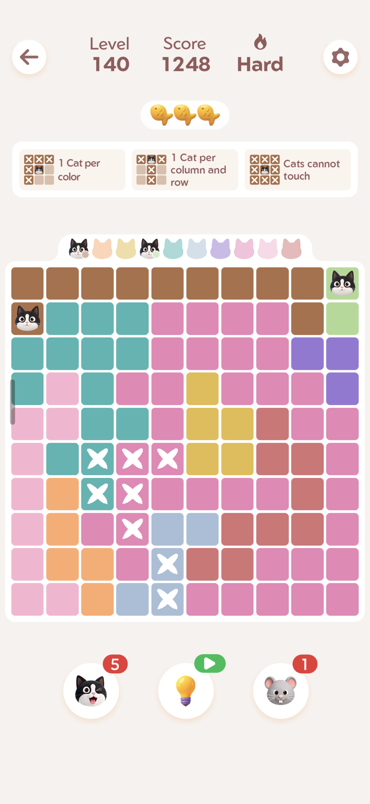
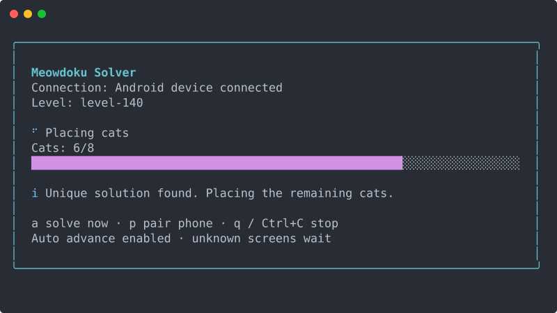

<div align="center">

# Meowdoku Solver

**Read the board. Find the cats. Play the next puzzle.**

A TypeScript controller that reads Meowdoku screenshots and solves puzzles on your Android phone.
Local image processing and OCR. No API keys or LLM calls during play.

[Get started](#get-started) · [Wireless debugging](#2-connect-your-phone) · [Commands](#commands) · [Troubleshooting](docs/troubleshooting.md) · [How it works](docs/architecture.md)

</div>

<table>
<tr>
<td width="34%" align="center" valign="top">

<br /><sub>A captured Meowdoku board.</sub>
</td>
<td width="66%" align="center" valign="middle">

<br /><sub>The actual terminal component, rendered with example values.</sub>
</td>
</tr>
</table>

It finds the grid, reads colors and existing cats, proves a unique solution, and sends the double-taps. Then it follows recognized completion screens and watches for the next puzzle. Existing crosses are treated as notes.

> **Experimental, unofficial Meowdoku project.** Not affiliated with or endorsed by Oakever Games. See the [disclaimer](#disclaimer). Tested on one Android phone; different layouts, themes, and devices may need adjustments. It captures the whole phone display, so keep the game visible and stop the controller before private activity.

## Get started

After cloning or downloading this project, open a terminal **inside its folder**.

### 1. Install what you need

```sh
./setup.sh
```

Setup reuses compatible tools or installs Node 24 and ADB inside `.tools/`, then installs the locked npm packages and checks TypeScript. No Android Studio, `sudo`, or shell-profile changes are needed.

Downloads come from [Node.js](https://nodejs.org/dist/) and [Google Android Platform-Tools](https://developer.android.com/tools/releases/platform-tools). Node downloads are checksum-verified; the ADB ZIP is checked for archive integrity.

macOS has been tested, including a fresh install without Node. Linux installation is available but has not been verified on Linux hardware. See [platform requirements](docs/development.md#platform-requirements) for prerequisites, Linux ARM64, and manual Windows setup.

### 2. Connect your phone

For wireless pairing, you need **Android 11 or later** and a phone and computer on the **same Wi-Fi network**. Google's [official wireless ADB guide](https://developer.android.com/tools/adb#connect-to-a-device-over-wi-fi) includes device screenshots and troubleshooting.

On the phone:

1. [Enable Developer options](https://developer.android.com/studio/debug/dev-options#enable), if needed. The settings location varies by manufacturer.
2. Open **Developer options → Wireless debugging** and enable it.
3. Choose **Pair device with pairing code**. Keep that dialog open.

In your terminal:

```sh
./run.sh --pair
```

The terminal asks for these values:

| Prompt                 | Where to find it                                                                        |
| ---------------------- | --------------------------------------------------------------------------------------- |
| Pairing IP:port        | The **Pair device with pairing code** dialog                                            |
| Six-digit pairing code | That same dialog                                                                        |
| Connection IP:port     | Close the dialog, then read **IP address & port** on the main Wireless debugging screen |

**The pairing port and connection port can differ.** Enter each address at the matching prompt. The pairing code is masked and is not saved.

After connection, **return to Meowdoku and leave an unlocked puzzle visible**. The controller starts checking automatically. You can also use an already-connected USB device with USB debugging enabled and the computer authorized.

### 3. Next time, just run

```sh
./run.sh
```

Pairing is normally remembered. The controller watches the screen, skips unchanged frames, and continues after each solved puzzle. Keep the phone awake and the game visible. Press **q** or **Ctrl+C** to stop.

On macOS, prevent idle laptop sleep for the duration of the run:

```sh
caffeinate -i ./run.sh
```

## Commands

Run these from the project folder:

| Command                      | What it does                                            |
| ---------------------------- | ------------------------------------------------------- |
| `./setup.sh`                 | Install missing tools and npm dependencies              |
| `./setup.sh --check`         | Check prerequisites without installing anything         |
| `./run.sh`                   | Start the terminal controller                           |
| `./run.sh --pair`            | Pair a phone, then start                                |
| `./run.sh --once --dry-run`  | Inspect one visible board and plan without sending taps |
| `./run.sh --once`            | Run one workflow and exit                               |
| `./run.sh --no-auto-advance` | Solve puzzles; leave advancement to you                 |
| `./run.sh --help`            | Show all launch options                                 |

Stop the controller before rerunning setup. If Node and npm are already on `PATH`, `npm start` remains available. For saved screenshots and developer commands, see [development](docs/development.md).

### Keyboard controls

These work in the **focused terminal**, without Enter:

| Key                | Action                                                   |
| ------------------ | -------------------------------------------------------- |
| **a**              | Check now, or queue one check after the current workflow |
| **p**              | Open wireless pairing after the current workflow         |
| **q** / **Ctrl+C** | Stop and clean up temporary runtime screenshots          |

During pairing, **Enter** submits a field and **Esc** cancels it. Pairing fields temporarily suspend the play shortcuts.

## What gets saved?

Each puzzle gets a folder under `levels/`:

```text
levels/level-140/
  input.png         Board captured before play
  output.json       Planned cells and tap coordinates
  preview.png       Grid and planned cats drawn over the input
  analysis/         Parsed board, geometry, and solution
  final.png         Capture after the placement attempt
  execution.json    Placement count and completion/failure state
```

Unnamed bonus puzzles get sequential names such as `golden-fish-001`. These IDs are local capture numbers, not game level numbers.

Temporary runtime PNGs are deleted on graceful exit. Level history, connection settings, replay guards, and audit logs are kept locally. `levels/`, `runtime/`, downloaded tools, and dependencies are excluded from Git; curated regression images live in `tests/fixtures/`.

`final.png` and `execution.json` record the placement attempt; they are not, by themselves, proof that the game accepted a win. Completed plans are not replayed, and interrupted placements require inspection before a new capture is prepared.

## How it works

```text
Screenshot → Read grid and marks → Prove a unique solution → Place cats → Advance
     ↑                                                                    │
     └──────────────────── Watch the next screen ─────────────────────────┘
```

The parser uses pixels to find the board. Local OCR reads level names and known continuation buttons. A constraint solver finds cat positions, and ADB sends the input. Screen coordinates come from the detected cells rather than a fixed resolution.

The game rules are one cat per row, column, and color, with no touching cats, including diagonally. Board size is detected automatically.

Want the details? Read [how screenshots become solutions](docs/architecture.md), including color sampling, mark detection, backtracking, and the boundaries between modules.

## When it waits

The controller waits on unreadable boards, unsupported screens, ads, and uncertain solutions. It does not buy hints or guess unfamiliar buttons. Overlays—including floating Edge panel handles—can cover the pixels it needs to read.

If it stops progressing, start with [troubleshooting](docs/troubleshooting.md). It covers Wi-Fi reconnects, the two pairing ports, obscured cells, laptop sleep, and interrupted attempts.

## Development

```sh
# If setup installed Node locally, enable it in this terminal first.
export PATH="$PWD/.tools/node/bin:$PATH"
npm test
npm run typecheck
npm run format:check
```

Tests exercise saved screenshots, generated boards, an independent solver oracle, fake devices, terminal controls, cleanup, and installer fixtures. They do not send input to your phone. See [development](docs/development.md) for individual capture/prepare/execute commands and setup details.

## Disclaimer

Meowdoku Solver is an independent project for learning and personal experimentation. It is not affiliated with, endorsed by, or sponsored by Oakever Games or the owners of Meowdoku.

Meowdoku's name, logos, artwork, characters, and game content belong to their respective rights holders. Game screenshots in this repository illustrate behavior and support regression testing. This project does not grant rights to those third-party assets or distribute the game itself.

Automation may conflict with the game's terms or policies and could result in account or access restrictions. Review the publisher's [Terms of Service](https://oakevergames.com/tos.html) and applicable law, and use automation only where permitted. Users are responsible for how they use this software.

This disclaimer does not provide publisher authorization, override game policies, or establish that a particular use is lawful. The software is experimental; correctness, device compatibility, and uninterrupted operation are not guaranteed.
